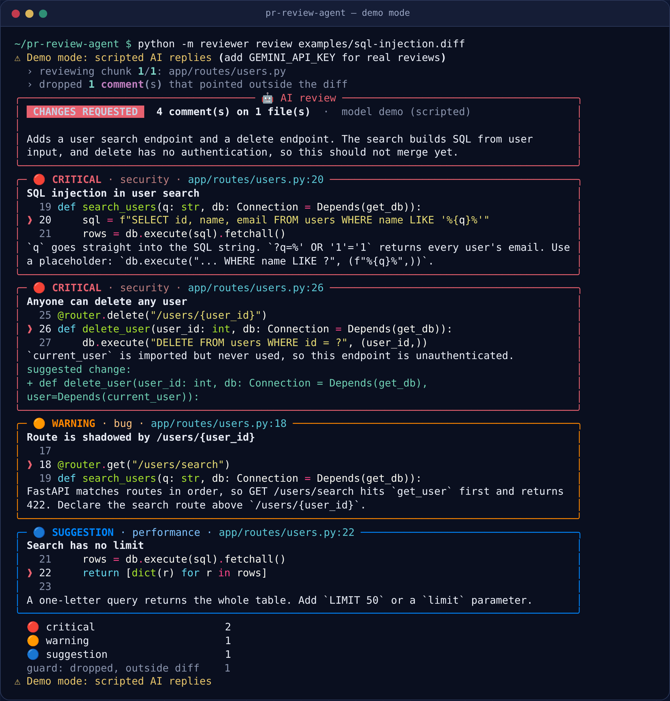

# 🔍 PR Review Agent

> **Day 16 of [30 Days of AI Agents](https://github.com/obiokoye)**: a GitHub Action that reads a pull request's diff, asks an LLM to review it, and posts inline comments with a severity, a reason and (when it fits on one line) a one-click suggested fix.




On GitHub, each finding becomes an inline review comment like this:

> 🔴 **Critical · security**: Anyone can delete any user
>
> `current_user` is imported but never used, so this endpoint is unauthenticated.
>
> ```suggestion
> def delete_user(user_id: int, db: Connection = Depends(get_db), user=Depends(current_user)):
> ```

## What it shows

- **An agent in CI**: it runs inside GitHub Actions on every `pull_request` event, reads the diff over the GitHub REST API and posts one review with inline comments. You don't need to check out the code.
- **Structured output**: the model must reply with JSON. Pydantic validates it, and if the reply is malformed the agent asks the model to fix it, once.
- **Grounding / hallucination guard**: every diff line is numbered before the model sees it. Comments that point at a line or file outside the diff are dropped before posting (the demo shows one being dropped).
- **Prompt-injection defence**: the PR description and diff are fenced as untrusted data, and the verdict is computed in code from severities. A PR that says "approve this" can't talk the bot into approving. The bot never approves anyway; a human does.
- **Context budgeting**: lockfiles, binaries and minified files are skipped, and big PRs are split into chunks that fit the model's budget.
- **Merge gate**: `fail-on: critical` fails the check when a critical issue is found, so branch protection can block the merge.
- **Swappable providers**: Gemini (free), Groq (free), OpenAI or Anthropic through one OpenAI-compatible client.
- **Offline tests**: a fake LLM and `httpx.MockTransport` stand in for the model and GitHub, so 32 tests run in CI with no keys.

## Use it on your repo (GitHub Action)

1. Get a free Gemini key at <https://aistudio.google.com/apikey> and add it as a repository secret named `GEMINI_API_KEY` (Settings → Secrets and variables → Actions).
2. Add `.github/workflows/ai-review.yml`:

```yaml
name: ai-review
on:
  pull_request:
    types: [opened, synchronize, reopened]
permissions:
  contents: read
  pull-requests: write
jobs:
  review:
    runs-on: ubuntu-latest
    steps:
      - uses: obiokoye/pr-review-agent@main
        with:
          gemini-api-key: ${{ secrets.GEMINI_API_KEY }}
          fail-on: never        # or: critical
```

Open a pull request and the review appears within a minute. This repo reviews its own PRs with the same action (`.github/workflows/ai-review.yml`, using `uses: ./`).

| Input | Default | What it does |
|---|---|---|
| `provider` | `gemini` | `gemini`, `groq`, `openai` or `anthropic` |
| `model` | provider default | Override the model |
| `gemini-api-key` / `groq-api-key` / `openai-api-key` / `anthropic-api-key` | empty | Key for the chosen provider. Empty = demo mode |
| `max-comments` | `10` | Cap on inline comments |
| `fail-on` | `never` | Fail the check at this severity or worse: `critical`, `warning`, `suggestion`, `nit` |
| `request-changes` | `false` | Post `REQUEST_CHANGES` instead of `COMMENT` when there is a critical finding |
| `ignore` | empty | Extra globs to skip, comma separated |

## Quick start (local CLI)

```bash
git clone https://github.com/obiokoye/pr-review-agent.git
cd pr-review-agent
python -m venv .venv && source .venv/bin/activate
pip install -r requirements.txt
cp .env.example .env    # add a free Gemini key, or leave it empty for demo mode
python -m reviewer review examples/sql-injection.diff
```

### Windows

```bat
git clone https://github.com/obiokoye/pr-review-agent.git
cd pr-review-agent
python -m venv .venv
.venv\Scripts\activate
pip install -r requirements.txt
copy .env.example .env
python -m reviewer review examples\sql-injection.diff
```

Other commands:

```bash
python -m reviewer review examples/laravel-orders.diff    # mass assignment, N+1, missing policy
python -m reviewer review --git main                      # review your current branch against main
python -m reviewer review examples/clean-refactor.diff --json
python -m reviewer pr owner/repo#12 --post                # needs GITHUB_TOKEN in .env
```

## Demo mode

With no API key (or `DEMO_MODE=true`), the reviewer prints **"Demo mode: scripted AI replies"** and uses the same fake LLM as the tests. It has scripted replies for the three diffs in `examples/`. Everything else runs for real: diff parsing, the prompt, Pydantic validation, the line guard, ranking and rendering. In the Action, demo mode posts a review with a banner telling you to add a key.

## Providers

| `LLM_PROVIDER` | Key variable        | Default model             | Free tier |
|----------------|---------------------|---------------------------|-----------|
| `gemini`       | `GEMINI_API_KEY`    | `gemini-2.5-flash`        | ✅ |
| `groq`         | `GROQ_API_KEY`      | `llama-3.3-70b-versatile` | ✅ |
| `openai`       | `OPENAI_API_KEY`    | `gpt-4o-mini`             | ❌ |
| `anthropic`    | `ANTHROPIC_API_KEY` | `claude-haiku-4-5`        | ❌ |

Override the model with `LLM_MODEL=...`.

## Project structure

```text
reviewer/
  diff.py      # unified diff parser: line numbers, commentable lines, filters, chunking
  prompts.py   # system prompt + untrusted-input fencing
  agent.py     # the pipeline: ask -> validate -> retry -> guard -> rank -> verdict
  models.py    # Pydantic models for comments and reviews
  llm.py       # provider table, OpenAI-compatible client, FakeLLM
  demo.py      # scripted replies for demo mode
  github.py    # GitHub REST: fetch diff, post review (with a fallback on 422)
  render.py    # GitHub markdown + rich terminal output
  cli.py       # `review`, `pr` and `action` commands
action.yml     # composite GitHub Action
examples/      # sample diffs (FastAPI, Laravel, a clean refactor)
tests/         # pytest, no network or API key needed
```

## Extending it

- **New rule of thumb for the model**: edit `SYSTEM_PROMPT` in `reviewer/prompts.py` (for example "flag any query without a LIMIT").
- **New severity or category**: add it to the `Literal` types in `reviewer/models.py` and an icon in `reviewer/render.py`.
- **Skip more files**: add globs to `DEFAULT_IGNORE` in `reviewer/diff.py`, or pass `ignore:` to the action.
- **Another provider**: add an entry to `PROVIDERS` in `reviewer/llm.py` (any OpenAI-compatible endpoint works).

## Security notes

- Use `pull_request`, not `pull_request_target`. PRs from forks then get no secrets and a read-only token, so untrusted code can never see your API key (the review just won't be posted on fork PRs).
- The workflow only needs `contents: read` and `pull-requests: write`.
- The diff is sent to your LLM provider. Don't run it on code you aren't allowed to share with that provider.

## Run tests

```bash
pytest -q
```

New to Python? See **[LEARN.md](LEARN.md)**, which walks through this codebase in Laravel terms.

---

MIT © Nicholas Okoye
